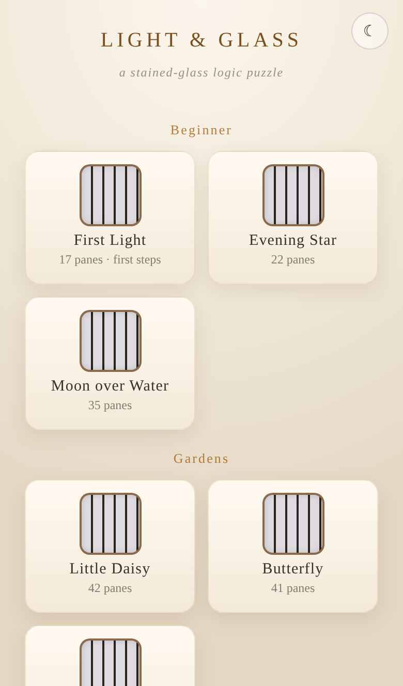
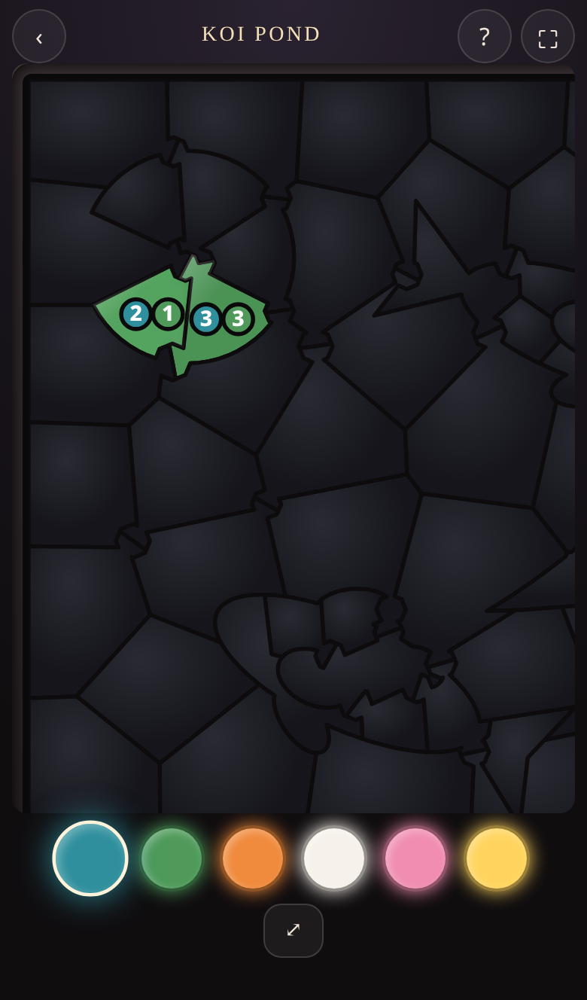
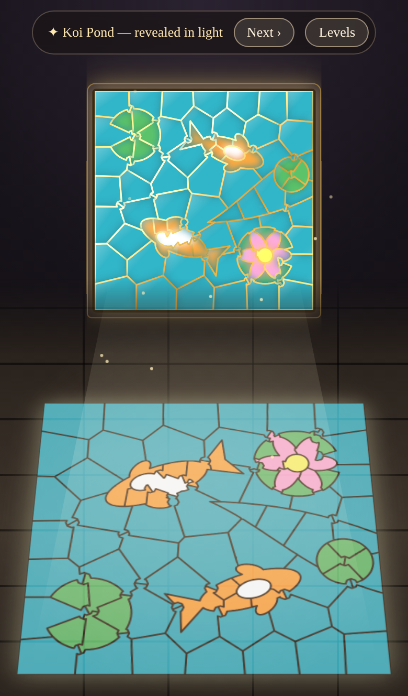
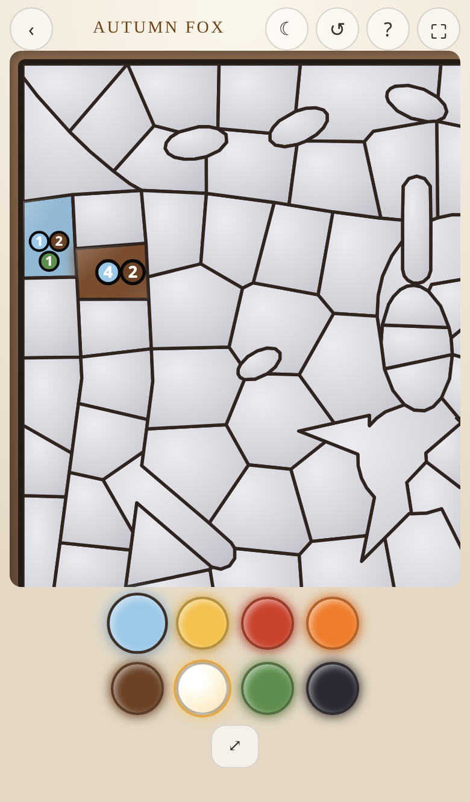
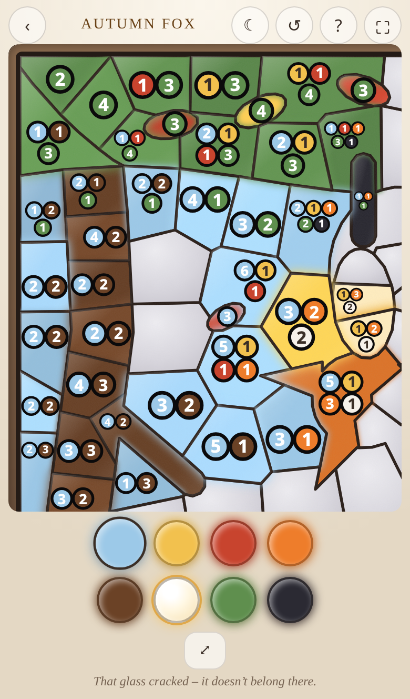
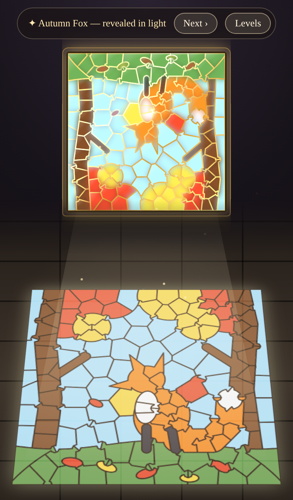

# Light & Glass

A touch-first logic puzzle for phones. A stained-glass window hangs over a dark chapel floor. Work out the colour of every glass pane. Once the window is complete, light shines through it and projects the hidden picture, upright, onto the floor.

**Play:** open [`index.html`](index.html) in a mobile browser. It is a single offline file with no dependencies.

## Rules (Free Glass)
- The window is made of irregular glass panes. Two panes are **neighbours** if they share a lead-line border. Corners never count: every border is long enough to see clearly, and only three panes ever meet at a point.
- A **lit** pane shows coloured badges. Each badge tells you how many of its neighbours have that colour.
- Every colour you place correctly lights its pane, which reveals new clues. Each puzzle can be solved by logic alone, with no guessing.
- A wrong colour cracks the pane and it resets. Try to finish flawless.
- Tap a lit pane to highlight its neighbours. Pinch to zoom and drag to pan.

## Levels
| Level | Panes | Colours |
|---|---|---|
| Glass Blossom | 75 | 5 |
| Koi Pond | 80 | 6 |
| Swan at Dusk | 94 | 6 |
| Autumn Fox | 149 | 8 |
| Alpine Lake (3:2, from a picture) | 236 | 11 |

Every colour also carries a small symbol (on its palette gem and in the number badges), assigned by colour family so the same kind of colour gets the same symbol in every window. Symbols are UI only (not part of level data or save fingerprints) and can be switched off with "Colour symbols" in the menu or the rules (stored under `lightglass.symbols`).

## Layout
- `index.html`: the playable build.
- `src/`: `template.html` and `assemble.sh`. Run `sh src/assemble.sh` to rebuild `index.html` from `levels/levels_free.json`.
- `levels/`: `levels_free.json` (the shipped levels) and the per-level `lv_*.json` files.
- `tools/freeglass/`: the generator (`freeglass2.py`, which uses `freeglass.py` and `solver2.py`) and the independent validator (`validate_json.py`).
- `tools/tests/`: Playwright touch tests.
- `docs/screenshots/`: current screenshots.
- `archive/`: retired square-grid (classic and Glow) levels, solvers, tests and old templates.

## Generating and validating
Requires Python 3 with `shapely`, `numpy` and `scipy`.
```
cd tools/freeglass
python freeglass2.py freefox     # writes lv_freefox.json (also freeflower, freekoi, freeswan)
python validate_json.py          # checks levels/levels_free.json: unique, no-guess, no short borders, junctions ≤ 3
```
Copy any regenerated `lv_*.json` into `levels/` and merge it into `levels_free.json`, then run `src/assemble.sh`.

### Levels from pictures (`tools/freeglass/raster.py`)
```
python tools/freeglass/raster.py levels/source/mountains.json --quant-only   # palette check + quantised preview (out_*_quant.png, out_*_compare.png)
python tools/freeglass/raster.py levels/source/mountains.json                # full level -> out_alpinelake.json (+ metrics)
```
The config lists a fixed palette (glass colour + typical source colours as anchors) with a minimum pairwise OKLab distance, optional spatial overrides (for example sky-coloured pixels low in the picture become lake), speckle clean-up, pane spacing and start limits. The window keeps the picture's aspect (stored as `aspect`, width 1 and height 1/aspect); the game, validator and floor reveal all handle non-square windows. Append the output to `levels_free.json` without touching existing entries, so their fingerprints and players' progress stay the same.

## Tests
Requires `playwright` and a Chrome/Chromium browser.
- [`tools/tests/freetouch.py`](tools/tests/freetouch.py): emulates iPhone 13, iPhone SE, Pixel 7 and Galaxy S9+. Covers tap, wobbly tap, pinch, pan, tap while zoomed, and whether the palette fits.
- [`tools/tests/freetest.py`](tools/tests/freetest.py) `<level> <name>`: takes start, mid and win screenshots, checks neighbour highlighting and cracks, and plays the level to a win.

## Screenshots
| Menu | Koi start | Koi win | Fox start | Fox mid | Fox win |
|---|---|---|---|---|---|
|  |  |  |  |  |  |

## Zoom, badges and bubble
Zoom goes up to 10× (pinch; the ⤢ button cycles fit → comfortable → 4× → 10×); the board re-renders crisply when the gesture ends. Badges scale with the pane, so at max zoom every badge of every pane is shown (no overflow). Tapping a lit pane highlights its neighbours and opens a bubble listing all neighbour counts large (symbol + number); tap elsewhere to dismiss. `tools/tests/zoomtest.py` checks all of this on iPhone 13 and SE. Note the slate symbol is now a bolt (a "+" glyph was easy to misread as a "+N" overflow).

## Level select and small levels
Sections: Beginner (First Light, Evening Star, Moon over Water), Gardens (Little Daisy, Butterfly, Cottage), Showpieces (Glass Blossom, Koi Pond, Swan at Dusk, Autumn Fox, Alpine Lake). New levels are appended to `levels_free.json` (display order is set by `SECT` in the template), so existing levels and fingerprints are unchanged. `tools/freeglass/small_levels.py` holds the hand-designed shapes and picks a seed by pane count, start count and mono share. First Light shows a one-time hint sequence (flag `lightglass.tutorial.v1`, separate from the save). `tools/tests/smalltest.py` plays every small level with real taps.

Replay: solved levels can be played again. The win bar has "↺ Play again" (below the floor picture) and solved level cards carry a small ↺ button; both confirm, then clear placed panes and cracks while keeping the solved/flawless marks and fingerprint (save key unchanged). `tools/tests/replaytest.py` wins, replays from the win bar and from the card, and wins again.

## Options
The ⚙ button (top right) or "⚙ Options" on the title / level-select screen opens the Options screen:
- **App theme** (menus, options, collection) and **Puzzle theme** (the playing screen, board and win reveal) are separate, each Auto / Light / Dark ("Auto" follows the phone), so e.g. app dark + puzzle light works. Stored under `lightglass.theme.app` and `lightglass.theme.puzzle`.
- Migration: if the new keys are missing, the old single `lightglass.theme` value (`light` / `dark`) is copied into both, so existing players keep their look (no old value = Auto/Auto). The old key is left in place.
- The quick ☀/☾ buttons (menu and playing screen) flip the screen you are on and set both themes to the same value; use Options to set them apart.
- **Sound** (`lightglass.sound`), **Colour symbols** (`lightglass.symbols`, same switch as before), **Reset tutorial** (removes only `lightglass.tutorial.v1`), and a note that saves stay on this device.
- Test: [`tools/tests/optionstest.py`](tools/tests/optionstest.py) (iPhone 13 and SE, real touch taps; independence, persistence, migration, toggles, reset). `tools/tests/run_all.sh` runs the whole suite.
